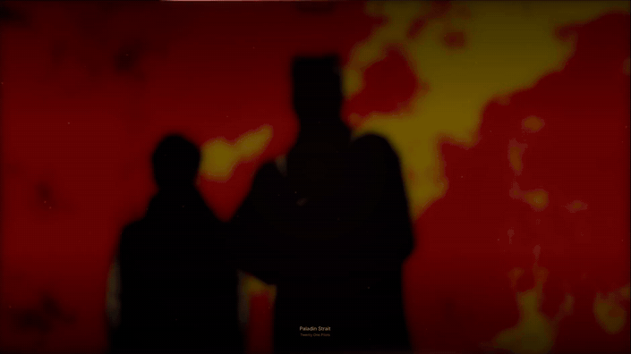

# Asterism

Synced lyrics drawn on your Linux desktop as constellations that move with the music. Works with Spotify,
YouTube Music and any other player that supports MPRIS.



Each word appears as a star at the moment it is sung, and the stars of a line link into a constellation.
An asterism is a pattern of stars; here, every lyric line becomes one.
The colours come from the album cover, and the size, motion and brightness follow the beat, the loudness
and the mood of the song.

Built for **Hyprland** with [Quickshell](https://quickshell.org). [Spicetify](https://spicetify.app) is optional and adds
word-level timing for Spotify.

## Features

- **Any player.** Spotify, the YouTube Music desktop app, a browser tab, mpv: anything that reports its track
  over MPRIS. Spotify with the Spicetify extension gets the best timing.
- **Word-by-word lyrics.** Uses real word timing when it is available, and estimates it from line timing otherwise.
- **Two modes.** A click-through overlay above your windows, and a fullscreen mode with a blurred album-cover
  backdrop, ambient light and a starfield. `Esc` leaves fullscreen.
- **Album-cover colours.** The dominant vivid colour of the cover tints the stars, the glow, the border and the backdrop.
- **Music-reactive.** Reads the audio with `cava`: the active word bounces on the beat, effects stay calm in quiet
  sections and open up when the song lifts, and calm and energetic songs get different animation styles.
- **Anticipation.** A faint ghost star shows where the next word will land.
- **Instrumental breaks.** Before the first line, the title and artist take the centre with a thin line that fills as the lyrics approach. In mid-song breaks the song colour pulses harder with the beat.
- **Running border.** A light circles the screen edge in the song's colour, faster when the music is loud.
- **Multi-monitor.** In fullscreen, the other monitors get a soft edge glow in the song's colour. They stay usable.
- **Controls.** IPC commands, a state file for bar buttons, and a remembered on/off state.

## Requirements

| Needed | Notes |
|---|---|
| Hyprland | Uses layer-shell and Hyprland's focus grab. |
| Quickshell | Tested with 0.3.2. |
| Qt 6.8 or newer | With `qt6-websockets`. Tested with Qt 6.12. |
| A music player with MPRIS | Spotify, the [YouTube Music desktop app](https://github.com/th-ch/youtube-music), a browser tab, mpv with `mpv-mpris`, and so on. |
| Spicetify | Optional, for Spotify. Adds Spotify's own lyrics and exact word timing. Needs Spicetify already working (`spicetify backup apply` has succeeded once). Tested with Spicetify 2.43. |
| `cava` | Optional. Without it lyrics work, but nothing reacts to the music. |
| Inter font | Optional. Any font works; set `fontFamily`. |
| Spicy Lyrics | Optional. A Spicetify Marketplace extension; when installed, songs it has word-synced lyrics for get exact word timing. |

Arch Linux:

```bash
sudo pacman -S quickshell qt6-websockets cava inter-font
```

Install Spicetify from [spicetify.app](https://spicetify.app) or the AUR. With the AUR `spotify` package,
Spicetify needs write access to the Spotify folder before it can apply anything:

```bash
sudo chmod a+wr /opt/spotify
sudo chmod a+wr /opt/spotify/Apps -R
```

Audio must play through this computer for the music-reactive effects; they stay still while Spotify
plays on another device.

## Install

```bash
git clone https://github.com/nsavinda/asterism.git
cd asterism
./install.sh
```

The installer checks the dependencies, copies the Quickshell config to `~/.config/quickshell/lyrics/`,
registers the Spicetify extension, and starts the overlay. It never uses `sudo`, and it backs up any file
it replaces as `<name>.bak`. It asks before running `spicetify apply`, because that restarts Spotify.

Then play a song with lyrics.

To start it at login, add this to your Hyprland config:

```ini
exec-once = qs -c lyrics
```

To remove everything: `./uninstall.sh`.

## Usage

| Action | Command |
|---|---|
| Fullscreen on / off | `qs -c lyrics ipc call lyrics fullscreen` (`Esc` also exits) |
| Lyrics on / off | `qs -c lyrics ipc call lyrics toggle` |
| Force on / off | `qs -c lyrics ipc call lyrics on` / `off` |
| Start / stop the overlay | `qs -c lyrics &` / `pkill -f "^qs -c lyrics"` |

The overlay starts in fullscreen when lyrics are on. `Esc` drops to the click-through overlay.
In fullscreen, the cursor and the `Esc` hint hide after a few seconds without mouse movement.

For bar buttons (Waybar, Quickshell, end-4 `ii`) and keybinds, see [docs/bar-button.md](docs/bar-button.md).

## Settings

All settings are at the top of `~/.config/quickshell/lyrics/shell.qml`. After editing, restart the overlay:

```bash
pkill -f "^qs -c lyrics"; qs -c lyrics &
```

| Setting | Default | What it does |
|---|---|---|
| `offsetMs` | `150` | Shows lyrics earlier (positive) or later (negative). Try `0` with word-synced lyrics, and a negative value with Bluetooth headphones. |
| `fontFamily`, `fontSize` | `"Inter"`, `96` | Font and size of the active word. |
| `accent` | `#b388ff` | Colour used when the cover has no usable colour. |
| `dynamicColor` | `true` | Take colours from the album cover. |
| `startFullscreen` | `true` | Open in fullscreen when lyrics turn on. |
| `musicReactive`, `beatPulse` | `true`, `0.3` | React to audio, and how much the active word grows on a beat. |
| `bounceBeat` | `true` | The beat pulse rises and falls like a bounce. |
| `dynamics` | `true` | Scale effects by how far the music is above its recent loudness. |
| `moodAdaptive` | `true` | Different animation style for calm and energetic songs. |
| `ghostStars` | `true` | Show where the next word will land. |
| `immersive`, `particleReact` | `true`, `1.0` | Fullscreen backdrop, ambient light and starfield, and how strongly the starfield moves. |
| `runningBorder`, `borderWidth`, `borderGlow`, `borderSpeedMs`, `beatBorder` | on | The light around the screen edge. |
| `ambientMonitors` | `true` | Edge glow on the other monitors in fullscreen. |
| `idleHideMs` | `3500` | Delay before the cursor and hint hide in fullscreen. |
| `interludeCard`, `interludeMinMs` | `true`, `3000` | Title card before the first line and stronger colour pulse in mid-song breaks, and how long a gap between lines counts as a break. |
| `anyPlayer` | `true` | Follow any MPRIS player, not only Spotify through the extension. |
| `port` | `8975` | WebSocket port. Change it in `lyrics-bridge.js` too. |

To pin the overlay to one monitor, uncomment the `screen:` line in the `PanelWindow`.

## How it works

```
Spotify + Spicetify extension (lyrics-bridge.js)          any other player
   │  finds lyrics, reads the cover colour,                   │  track, position and cover
   │  follows playback                                        │  over MPRIS
   │  JSON over WebSocket, ws://127.0.0.1:8975                │
   ▼                                                          ▼
Quickshell config "lyrics" (shell.qml + Constellation.qml)
   • draws the overlay on a Wayland layer-shell surface
   • reads audio levels from cava
   • for MPRIS players: fetches lyrics from LRCLIB and picks the colour from the cover
```

The overlay follows whichever player is playing. Spotify with the extension connected takes priority
while it plays. `qs -c lyrics ipc call lyrics source` prints which player and lyric source are in use.

### Lyric sources

For Spotify with the extension, these are tried in order:

1. **Spicy Lyrics' local cache**, if you have the [Spicy Lyrics](https://github.com/Spikerko/spicy-lyrics)
   extension installed. This is where real word timing comes from. Asterism only reads what Spicy Lyrics
   has already saved inside Spotify. It sends nothing to Spicy Lyrics' servers and is not affiliated with that
   project. A Spicy Lyrics update can change the cache format, in which case this source is skipped.
2. **Spotify's own lyrics**, line-synced.
3. **[LRCLIB](https://lrclib.net)**, line-synced.

Every other player (and Spotify without the extension) uses **LRCLIB** only. Titles from video sites are
cleaned up first ("Artist - Song (Official Video)" becomes artist and song), but a track with an unusual
title may find no lyrics.

For line-synced lyrics, word times are estimated by spreading a line's words across its duration.

### Network and privacy

The overlay loads the cover image from the address the player reports. For players other than Spotify with
the extension, it also asks `lrclib.net` for lyrics, sending the song title, artist, album and duration.
The extension talks to Spotify's lyrics endpoint, `lrclib.net` (the same details) and Spotify's image CDN.
The WebSocket listens on `127.0.0.1` only. Set `anyPlayer` to `false` to follow Spotify through the
extension only.

## Troubleshooting

| Problem | What to check |
|---|---|
| Nothing appears | Run `qs -c lyrics` in a terminal and read the log. Check that lyrics are on: `qs -c lyrics ipc call lyrics on`. |
| `module "QtWebSockets" is not installed` | Install `qt6-websockets`. After a Qt update, a self-built Quickshell needs a rebuild. |
| No lyrics from YouTube Music or another player | Check `playerctl -l` lists the player and `playerctl metadata` shows a title and artist. `qs -c lyrics ipc call lyrics source` shows what the overlay sees; `lyrics: none` means LRCLIB had no synced lyrics for that title. |
| No lyrics arrive from Spotify | Run `spicetify apply`. Then `spicetify enable-devtools`, restart Spotify, and check the console for `lyrics-bridge` errors. |
| A song has no lyrics | The log line `lyrics track: … source: none` means no source had synced lyrics for it. |
| Lyrics run early or late | Adjust `offsetMs`. Bluetooth headphones delay the audio, so they need a lower value. |
| Nothing reacts to the music | `cava` must be installed, and the audio must play through this computer (not Spotify Connect to a phone or speaker). |
| Port already in use | Change `port` in `shell.qml` and `PORT` in `lyrics-bridge.js`, then reinstall. |
| Keyboard stuck in fullscreen | Click a window on another monitor, or press `Esc` on the lyrics screen. |

The log shows what each song used:

```
lyrics track: Artist - Title | source: spicy-syllable | lines: 39 | colors: {…}
```

`qs -c lyrics ipc call lyrics mood` prints the detected mood and beat count.

## Limitations

- Hyprland only. Other wlroots compositors would need the focus grab replaced.
- The Spicetify extension needs the Spotify desktop client; Spicetify does not support the Snap package.
- Players other than Spotify get line-synced lyrics only, and sync depends on how well the player reports
  its position over MPRIS. Browser tabs can drift after seeking.
- Word timing is exact only for songs that Spicy Lyrics has word-synced lyrics for.
- Mood detection is a heuristic based on bass onsets and loudness. It settles about ten seconds into a song.
- Tested on one machine (Arch Linux, 1080p at 144 Hz plus two 1440p monitors).

## Design notes

Several choices follow published research on music perception: anticipation before a musical peak is
rewarding in its own right (Salimpoor et al., 2011), people follow a bouncing motion far better than a flash
(Hove et al., 2013), music is matched to colour through emotion (Palmer et al., 2013), and visuals that do
not fit the music reduce enjoyment. So the effects stay calm by default and open up only when the song does.

## Development

Source lives in [`quickshell/`](quickshell) and [`spicetify/`](spicetify). `./install.sh --no-apply` copies
your changes into place and restarts the overlay; changes to `lyrics-bridge.js` also need `spicetify apply`.
[Claude.md](Claude.md) holds notes for working on the project with an AI coding agent.

## Credits

- [Quickshell](https://quickshell.org), [Spicetify](https://spicetify.app), [cava](https://github.com/karlstav/cava)
- [LRCLIB](https://lrclib.net) for open synced lyrics
- [Spicy Lyrics](https://github.com/Spikerko/spicy-lyrics) for word-synced lyrics in Spotify

Not affiliated with Spotify, Spicetify, Spicy Lyrics or LRCLIB.

## License

[MIT](LICENSE)
